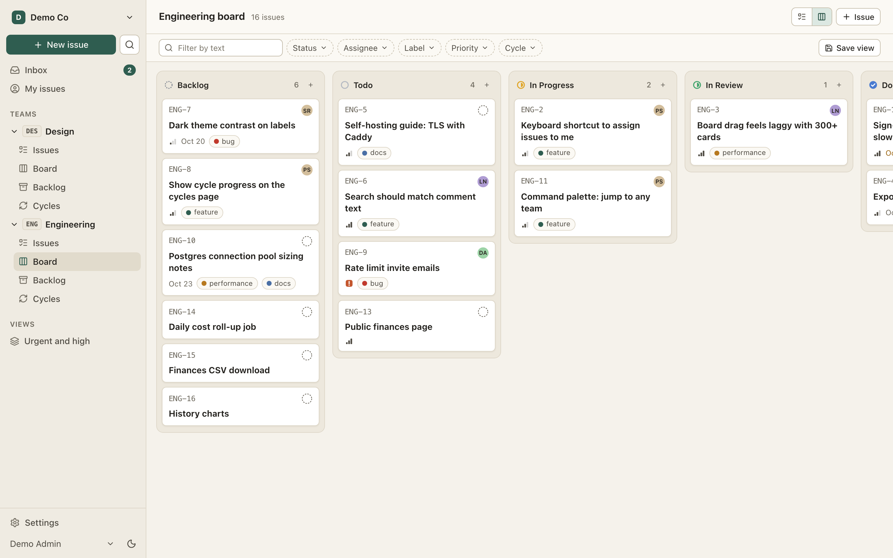
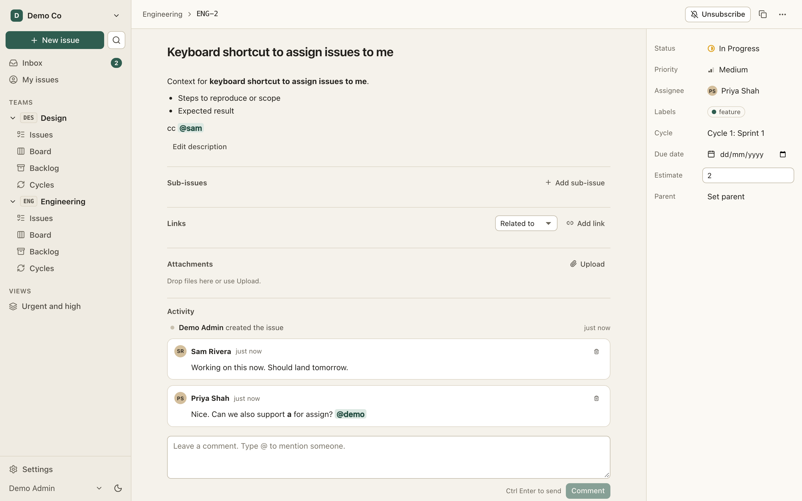
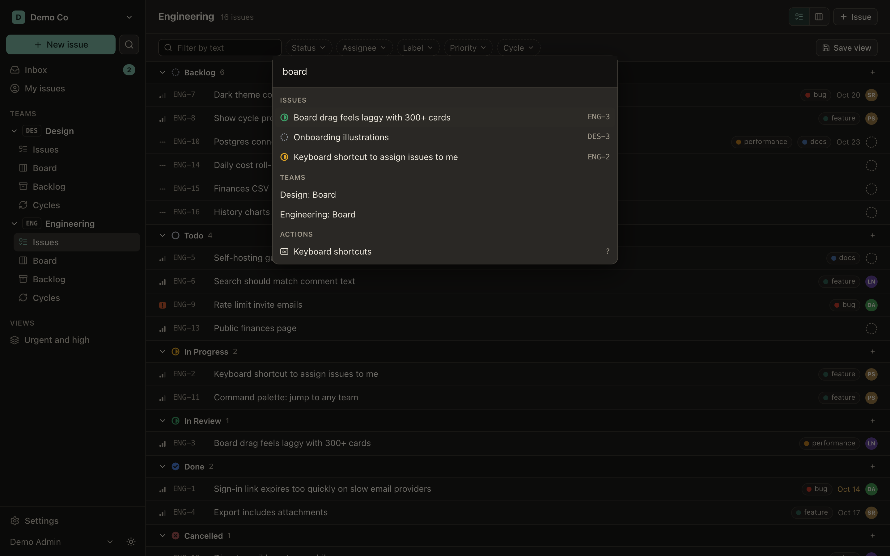

# Glasstrack

An open-source ticket tracker for software teams: issues, boards, cycles, keyboard-first, real-time. MIT licensed. Run by the numbers, in the open: [glasstrack.dev](https://glasstrack.dev)



## The mission

- **Free to self-host, with every feature.** No paid-only features, ever. SSO included, when it lands.
- **Hosted at cost.** The hosted service charges running cost plus 10% until a reserve covers six months of costs, then cost plus 2%. The price only ever goes down.
- **Public finances.** Income, every cost line, cost per workspace, the reserve and the current price are shown on a public page.
- **Efficiency is a feature.** Because price equals cost, the whole stack runs on one small server (2 vCPU, 4 GB RAM) for hundreds of teams. Postgres is the only stateful dependency.

## Features

- Workspaces, teams, members with admin, member and guest roles, invites by email or link
- Issues with markdown, status, priority, assignee, labels, due date, estimate, sub-issues and blocking/related links, human IDs like `ENG-123`
- List and board views with drag and drop, filters, saved views, full-text search
- Cycles (sprints) and a backlog
- Comments with @mentions and a full activity log on every issue
- Command palette (Cmd/Ctrl+K) and shortcuts: `c` create, `s` status, `a` assign, `p` priority, `?` for the rest
- Real-time updates across tabs and teammates
- In-app inbox plus email digests, with per-person settings
- One-click export of a whole workspace (JSON, CSV and attachments), and full workspace deletion
- Sign in with an email link, Google or GitHub
- Dark and light themes, keyboard navigable, works on phones
- REST API with personal tokens, signed outgoing webhooks ([docs/API.md](docs/API.md))
- Import from Linear, Jira and Trello
- GitHub: link pull requests by issue key, move issues to Done on merge
- Hosted mode: prepaid credit, daily pro-rata charges, Stripe top-ups, and a public finances page with every cost line
- **Free on every server, including self-hosted:** single sign-on (OIDC: Okta, Entra ID, Google Workspace, Keycloak, Authentik), time tracking, custom fields, recurring issues, templates, an audit log, multiple assignees, a timeline with dependencies, delivery reports, automations, private teams, free read-only viewers, request forms, email-to-issue and GitHub, GitLab and Gitea/Forgejo links. Other trackers charge extra for these.

| | |
|---|---|
|  |  |

## Self-host in 3 steps

You need Docker with the compose plugin.

```sh
git clone https://github.com/transparent-ai-businesses/glasstrack.git && cd glasstrack
sh scripts/init-env.sh          # creates .env with random secrets; set APP_URL and SMTP_URL
docker compose up -d            # app on http://localhost:3000
```

That runs the app and Postgres. Files are stored on a local volume.

- **HTTPS:** set `DOMAIN=glasstrack.example.com` and `APP_URL=https://glasstrack.example.com` in `.env`, then `docker compose --profile tls up -d`. Caddy gets a certificate automatically.
- **Managed Postgres (RDS, Neon, Hetzner, anything 15+):** set `DATABASE_URL` in `.env`.
- **S3 storage (AWS S3, MinIO, R2, Hetzner):** set `STORAGE_DRIVER=s3` and the `S3_*` variables.
- **Email:** any SMTP server, including AWS SES via its SMTP endpoint.
- **Backups:** `BACKUP_ENABLED=true` runs a daily `pg_dump` to your storage. See [Operations](#operations).

Every option is documented in [`.env.example`](.env.example). Moving from AWS to any other host is a change of environment variables.

## Operations

- `GET /health` (process up) and `GET /ready` (database reachable, migrations current).
- Logs are JSON lines on stdout.
- Migrations run when the container starts (`MIGRATE_ON_BOOT=true`).
- Backups: with `BACKUP_ENABLED=true` a job dumps the database daily to `backups/` in your storage. To check a backup really restores, run this daily from cron or a systemd timer. It restores the newest dump into a scratch database, checks it, drops it, and exits non-zero on failure:

  ```sh
  docker compose exec app node dist/restore-verify.js
  # cron example: 30 4 * * * cd /srv/glasstrack && docker compose exec -T app node dist/restore-verify.js || <alert command>
  ```

  One-off backup: `docker compose exec app node dist/backup.js`.

## Development

See [CONTRIBUTING.md](CONTRIBUTING.md) for setup, and [ARCHITECTURE.md](ARCHITECTURE.md) for the stack, data model, tenant isolation and the billing design.

```sh
pnpm install && pnpm migrate && pnpm seed && pnpm dev
pnpm lint && pnpm typecheck && pnpm test && pnpm build && pnpm test:e2e
```

## License

[MIT](LICENSE)
